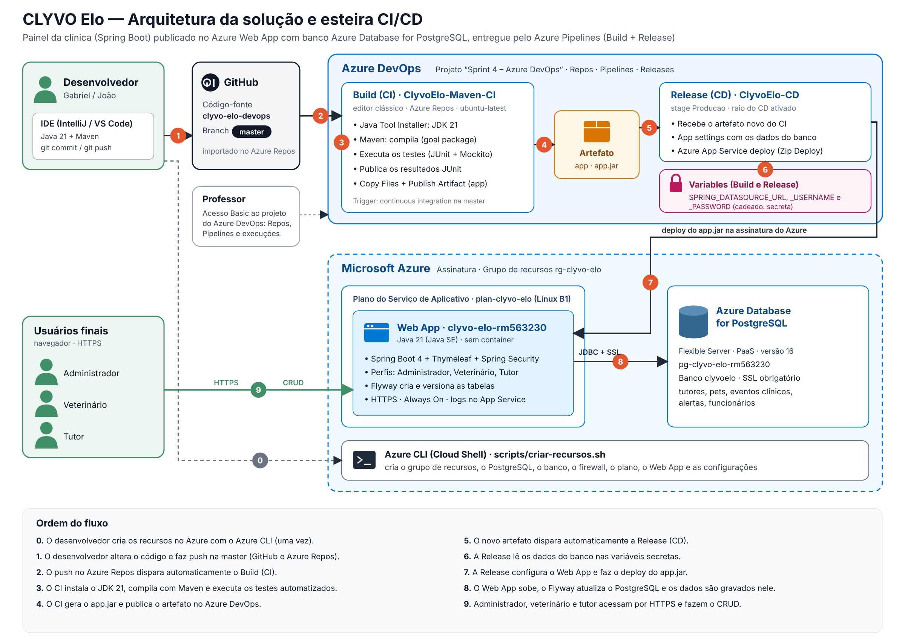

# CLYVO Elo — Painel da Clínica no Azure com CI/CD

Entrega da disciplina de **DevOps Tools & Cloud Computing (Sprint 4)** do Challenge FIAP 2026, proposto pela **CLYVO VET**.

O painel web do CLYVO Elo, feito em **Spring Boot**, é publicado no **Azure Web App** e usa o **Azure Database for PostgreSQL** como banco em nuvem. No **Azure DevOps**, um Build de **CI** compila, testa e publica o artefato a cada push, e uma Release de **CD** faz o deploy automático a cada artefato novo.

| | |
|---|---|
| Aplicação | https://clyvo-elo-devops-rm563230.azurewebsites.net |
| Azure DevOps | [a preencher] |
| Vídeo | [a preencher] |

## Integrantes

| Nome | RM | Turma |
|---|---|---|
| Gabriel Cabral Mendes Mariano | RM563230 | 2TDSPO |
| João Victor Santana dos Santos | RM566063 | 2TDSPX |

---

## 1. Descrição da solução

O desafio da CLYVO VET é manter a **jornada contínua de saúde do pet**. O cuidado não pode acabar quando o tutor sai da consulta. Hoje, o que mais se perde está entre uma visita e outra: o retorno do pós-operatório, a segunda dose da vacina, a orientação do veterinário e os sinais de alerta que o tutor percebe em casa.

O **Painel da Clínica** liga a clínica e o tutor depois da consulta. Ele tem três perfis:

| Perfil | O que faz |
|---|---|
| **Administrador** | Cadastra tutores, pets e a equipe, e acompanha os indicadores da clínica num dashboard |
| **Veterinário** | Agenda e atende os eventos clínicos (vacina, check-up, pós-operatório, medicação, exame), reagenda e acompanha os alertas até a resolução |
| **Tutor** | Vê a agenda e o histórico dos próprios pets, lê as orientações do veterinário e relata sintomas |

As tabelas centrais da solução são **tutor → pet → evento clínico / alerta**. O CRUD completo demonstrado na entrega é feito sobre **tutores e pets**, duas tabelas relacionadas por chave estrangeira.

### Benefícios para o negócio

- **Menos abandono de tratamento:** retornos e doses ficam agendados e aparecem como *Atrasado* quando vencem, para a clínica agir antes de perder o paciente.
- **Mais retorno à clínica:** cada cuidado agendado é uma nova visita, o que aumenta a recorrência e o faturamento.
- **Atendimento mais rápido aos problemas:** o relato do tutor e os alertas dos sensores entram numa fila única, com prioridade e responsável.
- **Tutor mais engajado e fiel:** ele vê o histórico, as orientações e quem está cuidando do caso do pet.
- **Entrega contínua e segura:** cada mudança no código é testada e publicada automaticamente, sem deploy manual e sem senha exposta no código.

### Stack

| Camada | Tecnologia |
|---|---|
| Aplicação | Java 21, Spring Boot 4, Spring MVC, Thymeleaf, Spring Security, Spring Data JPA, Bean Validation |
| Banco de dados | Azure Database for PostgreSQL Flexible Server 16 (PaaS), com tabelas versionadas pelo Flyway |
| Testes | JUnit 5, Mockito e AssertJ (testes unitários das regras de negócio) |
| Build | Maven |
| Nuvem | Azure App Service: Plano Linux B1 e Web App Java 21 (Java SE), sem container |
| Infraestrutura | Azure CLI (Cloud Shell), em `scripts/criar-recursos.sh` |
| CI/CD | Azure DevOps: Azure Repos, Build e Release no editor clássico, variáveis secretas |
| Código-fonte | GitHub, importado no Azure Repos, branch `master` |

---

## 2. Arquitetura e fluxo CI/CD



| Nº | Etapa | Onde acontece |
|---|---|---|
| 0 | Criação dos recursos no Azure (uma vez) | Azure CLI no Cloud Shell |
| 1 | O desenvolvedor altera o código e faz push na `master` | IDE, GitHub e Azure Repos |
| 2 | O push no Azure Repos dispara o Build (CI) | Azure Pipelines, pipeline `ClyvoElo-Maven-CI` |
| 3 | O CI instala o JDK 21, compila com Maven e roda os testes | Agente `ubuntu-latest` do Azure Pipelines |
| 4 | O CI publica o resultado dos testes e o artefato `app` com o `app.jar` | Azure DevOps (abas Tests e Artifacts) |
| 5 | O artefato novo dispara a Release (CD) | Azure Pipelines → Releases, `ClyvoElo-CD` |
| 6 | A Release lê os dados do banco nas variáveis secretas | Aba Variables da Release |
| 7 | A Release configura o Web App e faz o deploy do `app.jar` | Task Azure App Service deploy e Azure Web App |
| 8 | O Web App sobe e o Flyway atualiza o banco | Azure Web App e Azure Database for PostgreSQL |
| 9 | Os usuários acessam por HTTPS e fazem o CRUD | Navegador |

---

## 3. Estrutura do repositório

```
script_bd.sql              DDL das tabelas com comentários
scripts/
  criar-recursos.sh        criação dos recursos no Azure com Azure CLI
  excluir-recursos.sh      remoção dos recursos ao final
  consultas-crud.sql       SELECTs usados para comprovar o CRUD no banco
docs/arquitetura.png       diagrama da arquitetura e do fluxo CI/CD
pom.xml                    build Maven (gera target/app.jar)
src/main/java              aplicação Spring Boot
src/main/resources/db/migration   migrações Flyway (as mesmas tabelas do script_bd.sql)
src/test/java              testes automatizados executados no CI
```

---

## 4. Banco de dados em nuvem

- **Serviço:** Azure Database for PostgreSQL, Flexible Server (PaaS), versão 16, plano Burstable B1ms.
- **Servidor:** `pg-clyvo-elo-rm563230.postgres.database.azure.com`, banco `clyvoelo`, conexão com SSL obrigatório.
- **Estrutura:** a DDL completa, com chaves e comentários em cada tabela e coluna, está em [`script_bd.sql`](script_bd.sql).
- **Criação das tabelas:** a aplicação roda as migrações do Flyway no primeiro start (`src/main/resources/db/migration`). Elas criam as tabelas e inserem dados de demonstração com conteúdo real: tutores, pets, eventos clínicos e alertas.

| Tabela | Conteúdo |
|---|---|
| `painel_tutor` | Tutores dos pets |
| `painel_pet` | Pets, cada um ligado a um tutor |
| `painel_evento_clinico` | Agenda de cuidados de cada pet |
| `painel_alerta` | Alertas de saúde e o responsável por eles |
| `painel_alerta_acompanhamento` | Linha do tempo do acompanhamento dos alertas |
| `painel_funcionario` | Equipe da clínica (administradores e veterinários) |

---

## 5. Pipelines

As pipelines são montadas no **editor clássico** do Azure Pipelines: um **Build** para o CI e uma **Release** para o CD. O código fica no **Azure Repos**, importado deste repositório do GitHub, na branch `master`.

### CI — Build `ClyvoElo-Maven-CI`

- **Origem:** Azure Repos Git, repositório do projeto (o importado do GitHub), branch `master`.
- **Agente:** pool Azure Pipelines, `ubuntu-latest`.
- **Trigger:** *Enable continuous integration* na branch `master`. Todo push dispara o build.

| Task | Configuração | O que faz |
|---|---|---|
| Java tool installer | JDK 21, x64, Pre-installed | Deixa o agente com o Java 21 que o projeto usa |
| Maven | POM `pom.xml`, goal `package`, JUnit `**/surefire-reports/TEST-*.xml`, título *Testes do painel CLYVO Elo* | Compila, executa os testes automatizados e empacota o `app.jar`. Se um teste falhar, o build para |
| Copy Files | Contents `**/target/app.jar`, Target `$(build.artifactstagingdirectory)` | Separa o pacote da aplicação |
| Publish Artifact | Path `$(build.artifactstagingdirectory)`, artifact name `app` | Publica o artefato no Azure DevOps |

### CD — Release `ClyvoElo-CD`

- **Template:** Azure App Service deployment, stage **Producao**.
- **Artefato:** Build `ClyvoElo-Maven-CI`, versão Latest, com o **Continuous deployment trigger** (raio) ativado. Cada artefato novo gera uma Release.
- **Agente:** pool Azure Pipelines, `ubuntu-latest`.

| Configuração da task Azure App Service deploy | Valor |
|---|---|
| Azure subscription | a assinatura, autorizada pelo botão **Authorize** |
| App type | Web App on Linux |
| App Service name | `clyvo-elo-devops-rm563230` |
| Package or folder | `$(System.DefaultWorkingDirectory)/**/*.jar` |
| Startup command | `java -jar /home/site/wwwroot/app.jar` |
| App settings | `-SPRING_DATASOURCE_URL "$(SPRING_DATASOURCE_URL)" -SPRING_DATASOURCE_USERNAME "$(SPRING_DATASOURCE_USERNAME)" -SPRING_DATASOURCE_PASSWORD "$(SPRING_DATASOURCE_PASSWORD)"` |
| Deployment method | Zip Deploy |

### Variáveis protegidas

Nenhum usuário, senha ou token fica no código. Os dados do banco ficam na aba **Variables** do Build e da Release, com a senha marcada pelo **cadeado** como secreta: ela aparece como `***` nos logs. A Release repassa esses valores ao Web App pelas **App settings**. A aplicação lê as variáveis de ambiente `SPRING_DATASOURCE_URL`, `SPRING_DATASOURCE_USERNAME` e `SPRING_DATASOURCE_PASSWORD`.

| Variável | Valor | Secreta |
|---|---|---|
| `SPRING_DATASOURCE_URL` | `jdbc:postgresql://pg-clyvo-elo-rm563230.postgres.database.azure.com:5432/clyvoelo?sslmode=require` | Não |
| `SPRING_DATASOURCE_USERNAME` | `clyvoadmin` | Não |
| `SPRING_DATASOURCE_PASSWORD` | senha do banco | **Sim** |

---

## 6. Como fazer o deploy (How To)

### 6.1 Pré-requisitos

- Assinatura do Azure ativa (por exemplo, Azure for Students)
- Organização no Azure DevOps com execução de pipelines liberada
- Conta no GitHub

### 6.2 Criar os recursos no Azure (Azure CLI)

No [Portal do Azure](https://portal.azure.com), abra o **Cloud Shell** em modo **Bash** e rode:

```bash
az account show
git clone https://github.com/GabrielCabralmm/Clyvo-elo-DevOps.git
cd Clyvo-elo-DevOps/scripts
chmod +x criar-recursos.sh
./criar-recursos.sh
```

O script registra os provedores usados, pede a senha do administrador do banco e cria, em ordem:

| Recurso | Nome |
|---|---|
| Grupo de recursos | `rg-clyvo-devops` |
| Azure Database for PostgreSQL Flexible Server | `pg-clyvo-elo-rm563230` (usuário `clyvoadmin`) |
| Banco de dados | `clyvoelo` |
| Acesso ao banco | rede pública habilitada, com a regra de firewall `AllowAll` liberando todos os IPs |
| Application Insights | `ai-clyvo-elo-devops` |
| Plano do Serviço de Aplicativo | `clyvo-plan` (Linux, B1) |
| Serviço de Aplicativo | `clyvo-elo-devops-rm563230` (Java 21) |
| Configurações do Web App | Always On, somente HTTPS, comando de inicialização, porta, Application Insights e dados do banco |

Para usar outra região, rode `export LOCATION=eastus2` antes do script. O padrão é `chilecentral`.

### 6.3 Criar o projeto no Azure DevOps

1. Em **Organization settings → Pipelines → Settings**, deixe **desligadas** as opções *Disable creation of classic build pipelines* e *Disable creation of classic release pipelines*.
2. Em **New project**:
   - **Project name:** `Sprint 4 – Azure DevOps`
   - **Description:** `Projeto para entrega da Sprint 4 do professor <nome do professor>` e, nas linhas seguintes, `RM563230 - Gabriel Cabral Mendes Mariano - 2TDSPO` e `RM566063 - João Victor Santana dos Santos - 2TDSPX`
   - **Visibility:** Private · **Version control:** Git · **Work item process:** Scrum
3. **Importar o código:** em Repos → Files → **Import repository**, escolha o tipo Git e a Clone URL `https://github.com/GabrielCabralmm/Clyvo-elo-DevOps.git`.
4. **Convidar o professor:** em Organization settings → **Users** → **Add users**, coloque o e-mail do professor com **Access level: Basic** e adicione-o ao projeto `Sprint 4 – Azure DevOps` no grupo **Contributors**.

### 6.4 Criar o Build (CI)

1. Pipelines → **Create Pipeline** → **Use the classic editor**.
2. Source **Azure Repos Git**, repositório do projeto (o importado do GitHub), branch `master` → **Continue**.
3. Template **Maven** → **Apply**.
4. Name `ClyvoElo-Maven-CI`, Agent pool **Azure Pipelines**, Agent specification **ubuntu-latest**.
5. No **Agent job 1**, clique em **+**, adicione a task **Java tool installer** e arraste-a para antes da task Maven. Configure **JDK version 21**, **x64** e **Pre-installed**.
6. Task **Maven**: POM `pom.xml`, goal `package`, marque *Publish to Azure Pipelines* com Test results files `**/surefire-reports/TEST-*.xml` e título `Testes do painel CLYVO Elo`. Em **JDK version**, deixe **Default**, que usa o JDK 21 instalado no passo anterior.
7. Task **Copy Files**: Contents `**/target/app.jar`, Target Folder `$(build.artifactstagingdirectory)`.
8. Task **Publish Artifact**: Path `$(build.artifactstagingdirectory)`, Artifact name `app`.
9. Aba **Variables**: crie `SPRING_DATASOURCE_URL`, `SPRING_DATASOURCE_USERNAME` e `SPRING_DATASOURCE_PASSWORD`, com o cadeado na senha.
10. Aba **Triggers**: marque **Enable continuous integration** com a branch `master`.
11. **Save & queue** → comentário `Criação do primeiro CI`, branch `master` → **Save and run**. Confira o build com **Success**, a aba **Tests** e o artefato `app`.

### 6.5 Criar a Release (CD)

1. Pipelines → **Releases** → **New pipeline** → template **Azure App Service deployment** → **Apply**.
2. Nome da pipeline `ClyvoElo-CD` e nome do stage `Producao`.
3. **Add an artifact:** Source type Build, projeto `Sprint 4 – Azure DevOps`, source `ClyvoElo-Maven-CI`, versão Latest → **Add**.
4. Clique no **raio** do artefato e ative o **Continuous deployment trigger**. Deixe o *Pull request trigger* desligado.
5. No stage, clique em **1 job, 1 task**:
   - **Azure subscription:** escolha a assinatura e clique em **Authorize**
   - **App type:** Web App on Linux · **App service name:** `clyvo-elo-devops-rm563230`
   - **Agent job:** pool Azure Pipelines, `ubuntu-latest`
6. Task **Deploy Azure App Service**:
   - **Package or folder:** `$(System.DefaultWorkingDirectory)/**/*.jar`
   - **Startup command:** `java -jar /home/site/wwwroot/app.jar`
   - **Application and Configuration Settings → App settings:** cole em uma linha `-SPRING_DATASOURCE_URL "$(SPRING_DATASOURCE_URL)" -SPRING_DATASOURCE_USERNAME "$(SPRING_DATASOURCE_USERNAME)" -SPRING_DATASOURCE_PASSWORD "$(SPRING_DATASOURCE_PASSWORD)"`
   - **Additional Deployment Options → Deployment method:** Zip Deploy, se a opção aparecer
7. Aba **Variables** da Release: crie as mesmas três variáveis, com o cadeado na senha.
8. **Save** e depois **Create release** → descrição `Deploy em Producao` → **Create**. Acompanhe os logs do stage até o **Succeeded**.
9. Abra https://clyvo-elo-devops-rm563230.azurewebsites.net. O primeiro acesso depois do deploy pode levar cerca de 1 minuto.

### 6.6 Testar a esteira completa

1. No computador, clone o repositório e configure o push para o GitHub e para o Azure Repos ao mesmo tempo:
   ```bash
   git clone https://github.com/GabrielCabralmm/Clyvo-elo-DevOps.git
   cd Clyvo-elo-DevOps
   git remote set-url --add --push origin https://github.com/GabrielCabralmm/Clyvo-elo-DevOps.git
   git remote set-url --add --push origin <URL de clone do Azure Repos>
   ```
2. Altere um texto visível, por exemplo o título da tela de login em `src/main/resources/templates/login.html`.
3. `git commit -am "Altera o título da tela de login"` e `git push`.
4. Em Pipelines, o `ClyvoElo-Maven-CI` inicia sozinho. Confira os testes na aba **Tests** e o artefato `app`.
5. Ao terminar o CI, uma nova Release do `ClyvoElo-CD` é criada sozinha e faz o deploy.
6. Abra a aplicação no Web App e confira o novo título.

---

## 7. Como testar o CRUD com evidência no banco

Use qualquer cliente PostgreSQL conectado ao servidor: pgAdmin, DBeaver, Azure Data Studio ou a extensão PostgreSQL do VS Code. O banco aceita conexões públicas, com SSL. Os SELECTs estão em [`scripts/consultas-crud.sql`](scripts/consultas-crud.sql).

Entre como **Administrador** (`renata.souza@clyvovet.com` / `clyvo123`):

| Operação | Na aplicação | No banco |
|---|---|---|
| **Inserir** | Tutores → Novo tutor. Depois Pets → Novo pet, escolhendo esse tutor | `SELECT * FROM painel_tutor ORDER BY id_tutor DESC;` e `SELECT * FROM painel_pet ORDER BY id_pet DESC;` |
| **Consultar** | Listas de tutores e pets, com busca, e a ficha do pet | `SELECT` com `JOIN` de tutores e pets |
| **Atualizar** | Pets → Editar: troque a raça e o peso. Tutores → Editar: troque o telefone | `SELECT` do pet e do tutor alterados |
| **Excluir** | Na lista de pets, Excluir o pet criado; depois, na lista de tutores, Excluir o tutor | `SELECT COUNT(*)` mostrando que os registros não existem mais |

O painel não deixa excluir um tutor que ainda tem pets nem um pet com histórico clínico, para não perder dados de saúde. Por isso, a exclusão é feita no pet recém-criado e depois no tutor dele.

### Acessos de demonstração

Todos usam a senha `clyvo123`.

| Perfil | E-mail |
|---|---|
| Administrador | renata.souza@clyvovet.com |
| Veterinário | ana.ferreira@clyvovet.com |
| Tutor | gabriel.mariano@email.com |

---

## 8. Rodar localmente (opcional)

Com um PostgreSQL local e o banco `clyvoelo` criado:

```bash
export SPRING_DATASOURCE_URL=jdbc:postgresql://localhost:5432/clyvoelo
export SPRING_DATASOURCE_USERNAME=postgres
export SPRING_DATASOURCE_PASSWORD=<sua senha>
mvn spring-boot:run
```

Acesse http://localhost:8080. Para rodar só os testes, use `mvn test`.

## 9. Remover os recursos

Depois da avaliação, rode `./excluir-recursos.sh` na pasta `scripts`, no Cloud Shell, para apagar o grupo de recursos e parar a cobrança.
